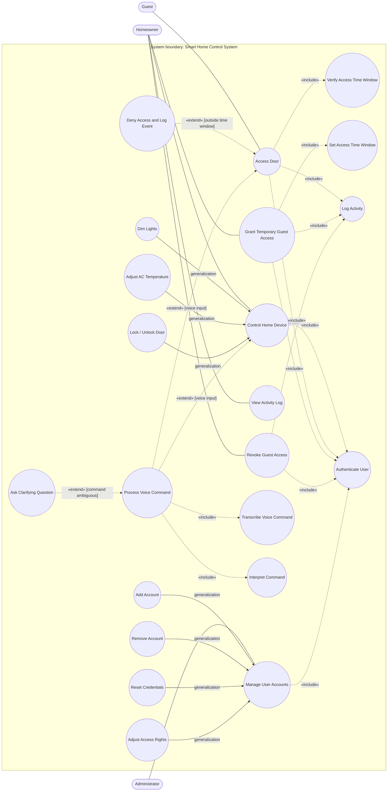
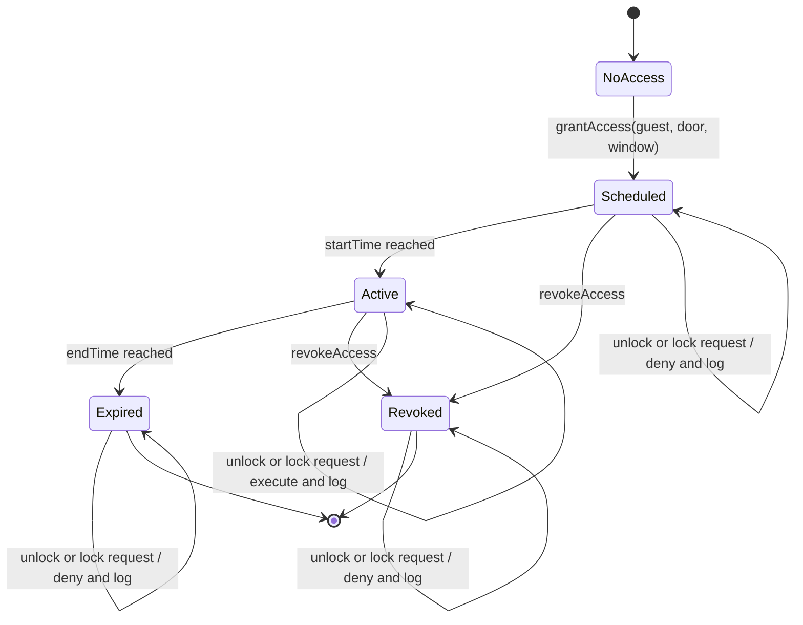
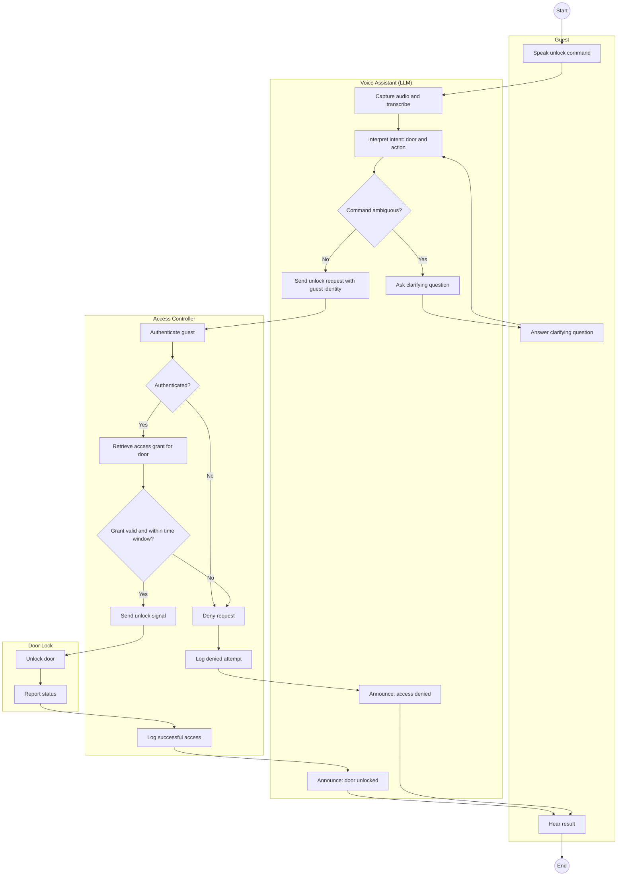
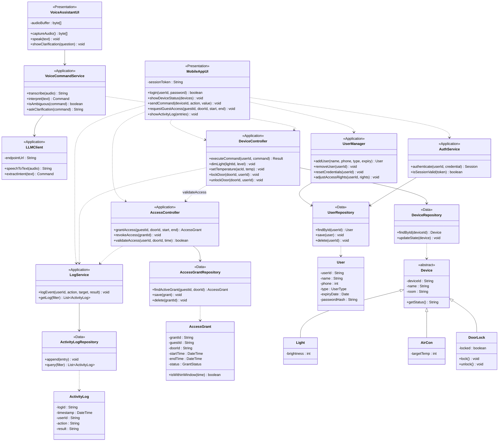
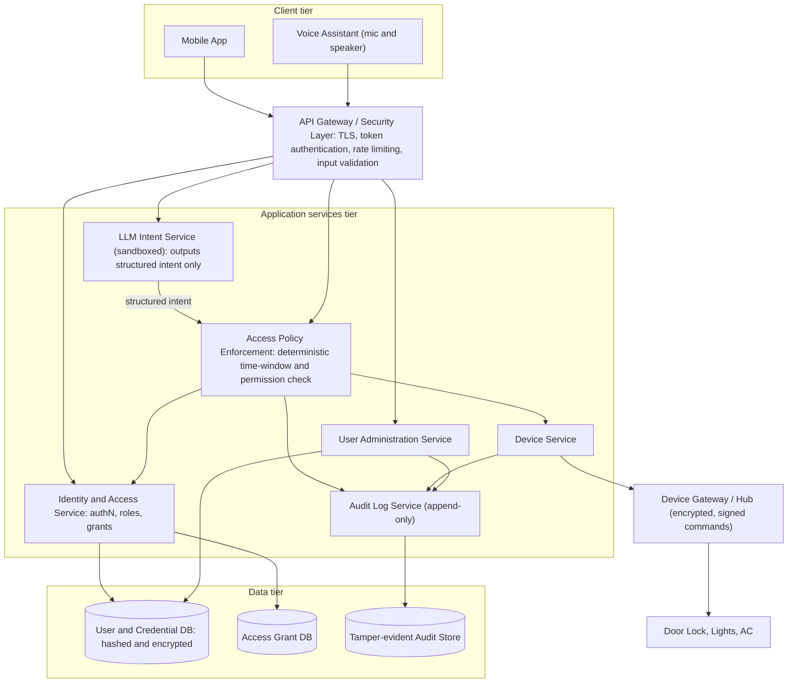
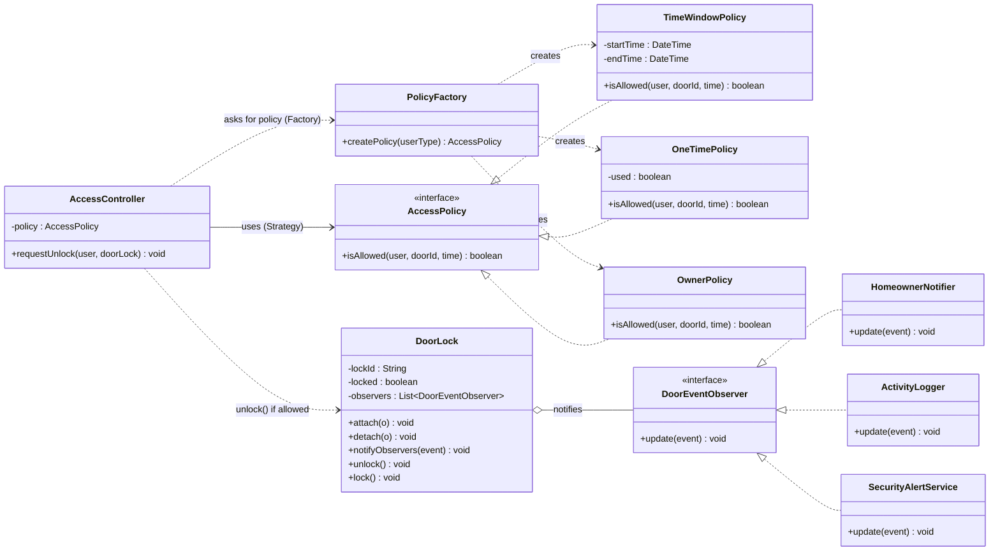

# SC2006/CZ2006 Software Engineering — Sem 1 AY2025-26 — Model Solutions

> Case: **Smart Home Control System (SHCS)** with LLM voice assistant. Actors in the appendix: Homeowner, Guest, Administrator.
> Diagrams are written in Mermaid so they render in any Markdown viewer. In the exam, redraw them by hand using the notation in your notes (see the companion *Reasoning Notes* file).
> Marks: Q1 = 25, Q2 = 4 + 8 + 5 + 8 = 25, Q3 = 8 + 8 + 6 + 3 = 25, Q4 = 4 + 4 + 5 + 4 + 8 = 25.

---

# Question 1

## 1(a) Actors, use cases and use case diagram (18 marks)

### Actors
| Actor | Type | Role |
|---|---|---|
| **Homeowner** | Primary | Controls devices (via app or voice); grants and revokes guest access |
| **Guest** | Secondary (primary for door access) | Locks/unlocks permitted doors within the time window set by the homeowner |
| **Administrator** | Primary | Manages accounts, credentials and access rights; does **not** control devices |

The LLM assistant is treated as part of the system (it appears as use cases inside the boundary), not as an actor.

### Use cases
- **Homeowner:** Dim Lights, Adjust AC Temperature, Lock/Unlock Door, Grant Temporary Guest Access, Revoke Guest Access, View Activity Log
- **Guest:** Access Door (lock/unlock)
- **Administrator:** Add Account, Remove Account, Reset Credentials, Adjust Access Rights
- **Supporting:** Authenticate User, Process Voice Command, Transcribe Voice Command, Interpret Command, Ask Clarifying Question, Set Access Time Window, Verify Access Time Window, Log Activity, Deny Access and Log Event

### Use case diagram

**How to read/draw it by hand**
- Solid lines = associations; hollow-triangle arrow = generalization (specialised case → general case).
- `«include»` arrow points from the **base** use case to the **included** one (mandatory sub-behaviour).
- `«extend»` arrow points from the **extending** use case to the **base** one (optional, conditional behaviour), with the condition written on the arrow.

---

## 1(b) Use case description: Door access by a Guest (7 marks)

| Field | Content |
|---|---|
| **Use case name** | Access Door (Guest unlocks a door) |
| **Actors** | Primary: **Guest**. Supporting: Voice Assistant (LLM), Door Lock. Stakeholder: Homeowner (granted the access, reads the log) |
| **Description** | A guest unlocks (or locks) a door using the mobile app or by speaking to the voice assistant, within the time window the homeowner defined |
| **Pre-conditions** | 1. The Homeowner has granted the Guest temporary access to that specific door lock (a grant with start time and end time exists). 2. The Guest has an active account and is registered in the system. 3. The Guest is authenticated (logged in on the app, or voice session linked to the Guest's identity). 4. The door lock is online and reachable by the system. |
| **Trigger** | Guest requests to unlock the door (taps *Unlock* in the app, or says e.g. "Unlock the front door") |

**Basic flow of events**
1. Guest sends an unlock request for a door (via app **or** voice).
2. *(Voice only)* The voice assistant transcribes the speech and interprets the command into an intent (door = front door, action = unlock).
3. The system authenticates the Guest.
4. The system retrieves the Guest's access grant for that door.
5. The system verifies that the **current time is within** the access time window and the grant has not been revoked.
6. The system sends the unlock command to the Door Lock.
7. The Door Lock unlocks and confirms its new state.
8. The system records the successful access (guest, door, time, result) in the activity log.
9. The system notifies the Guest (app message or spoken "The front door is unlocked").

**Alternative flows**
- **A1 – Ambiguous voice command (at step 2):** The assistant asks a clarifying question ("Which door — front or back?"); the Guest answers; flow resumes at step 2.
- **A2 – Outside time window / grant expired (at step 5):** The system denies the request, does not send any command to the lock, records the denied attempt in the log, and informs the Guest.
- **A3 – No grant for this door or access revoked (at step 4/5):** Same handling as A2, with the reason "no permission".
- **A4 – Authentication fails (at step 3):** The system rejects the request, informs the Guest, and logs the failed attempt.
- **A5 – Door lock unreachable (at step 6):** The system informs the Guest that the door cannot be reached, logs the failure; the door state is unchanged.

**Post-conditions**
- Success: the door is unlocked and the access is logged.
- Failure: the door state is unchanged and the denied/failed attempt is logged.

---

# Question 2

## 2(a) State machine: temporary guest access controller (4 marks)

The controller manages the lifecycle of one temporary access grant for one guest and one door.

| State | entry / | do / | exit / |
|---|---|---|---|
| NoAccess | – | wait for homeowner | – |
| Scheduled | store grant, start timer for startTime | monitor clock | cancel start timer |
| Active | log "access started" | accept lock/unlock requests, check each against window | log "access ended" |
| Expired | log "grant expired" | reject and log all requests | – |
| Revoked | log "grant revoked", cancel timers | reject and log all requests | – |

---

## 2(b) Activity diagram with swim lanes: unlocking a door via voice assistant by a guest (8 marks)

Swim lanes: **Guest**, **Voice Assistant (LLM)**, **Access Controller**, **Door Lock**.

Features to point out: one start, one end, two decision diamonds that branch to the **deny path**, a **loop** (clarification → re-interpret), and a **merge** where success and failure meet at "Hear result".

---

## 2(c) Waterfall vs Agile (5 marks)

| Aspect | Waterfall | Agile |
|---|---|---|
| **Flexibility** | Rigid, linear phases; assumes stable requirements; a change means going back and re-doing earlier phases (high cost of change) | Flexible; requirements evolve; backlog is re-prioritised every iteration, change is welcomed |
| **Customer involvement** | Mainly at the start (requirements) and the end (acceptance); the customer sees the product late | Continuous: Product Owner and customer give feedback in every sprint review |
| **Delivery approach** | Single "big-bang" delivery after all phases are done | Iterative and incremental: working software delivered every 1–4 weeks |

- **Advantage of Waterfall:** Well-documented, predictable timeline and budget for fixed-scope projects (e.g., a safety-critical lock controller with fixed regulatory requirements).
- **Advantage of Agile:** Early and continuous delivery of value with fast feedback, so wrong assumptions are caught early (e.g., guests find the voice command flow confusing in Sprint 2, and it is fixed in Sprint 3).

---

## 2(d) Sprints: two advantages and two challenges, with examples (8 marks)

**Advantage 1 – Early, frequent working increments give fast feedback.** Each sprint ends with a demo at the Sprint Review. *Example:* Sprint 1 delivers light and AC control through the mobile app; the homeowner tries it and asks for a clarifying-question feature for voice commands, which enters the backlog for Sprint 2 instead of being discovered at the end of the project.

**Advantage 2 – Adaptability and continuous improvement through time-boxing, re-planning and retrospectives.** The Product Owner can re-prioritise the Product Backlog at every Sprint Planning, and the Retrospective improves the process. *Example:* After a security review the team moves "enforce guest time window" ahead of "dim lights" in Sprint 2; the velocity measured in Sprint 1 (e.g., 20 points) lets the team commit realistically to later sprints.

**Challenge 1 – Estimating work to fit a fixed time-box; unfinished work spills over.** Story points are relative and unknown technology makes them unreliable. *Example:* "Integrate the LLM for voice transcription and interpretation" is estimated at 8 points but proves harder (latency, ambiguous phrases), so it does not meet the Definition of Done by sprint end and the Sprint Goal is missed.

**Challenge 2 – Changing requirements/scope creep during a sprint, plus integration/testing overhead.** The Sprint Backlog is fixed while the sprint runs, so urgent changes disrupt the plan, and some activities do not fit neatly in a short sprint. *Example:* Mid-sprint the homeowner wants guest access limited to specific weekdays; adding it jeopardises the sprint, so it must wait for the next sprint or displace committed stories. Similarly, hardware-in-the-loop tests of the door lock need long lead time and cannot be fully completed in a 2-week sprint.

---

# Question 3

## 3(a)(i) Proposed architecture and detailed class diagram (8 marks)

### Chosen architecture: **Three-tier (Layered) architecture**, Presentation → Application → Data

**Justification (tie to the case):**
- Two different clients (mobile app and voice assistant) share the **same business logic** in the Application tier, so rules such as the *strict time window* and *authentication* are enforced in one place, not duplicated in each client.
- Separation of concerns: UI can change without touching access rules; the data tier (users, grants, logs) can be changed or scaled independently.
- Clear place to put the audit log and security checks; layers can be developed and tested in parallel.
- Trade-off accepted: communication overhead and no layer skipping (clients cannot reach the database directly), which is desirable for security.

### Class diagram (organised by tier)

**Rules that reflect the architecture:** arrows only go Presentation → Application → Data (never Presentation → Data); entities (`User`, `AccessGrant`, `Device`, `ActivityLog`) are passed between layers; the time-window rule lives in `AccessController.validateAccess()` and `AccessGrant.isWithinWindow()` in the Application tier.

---

## 3(a)(ii) One relevant non-functional requirement and an alternative architecture (8 marks)

### Non-functional requirement: **Security** (access control, authentication, integrity of the audit log)

**Why Security?** The system controls physical door locks. The appendix demands a *strict time window*, *logging of all activity* and that *users are properly authenticated*. The LLM adds new risks: a spoken or injected phrase (prompt injection, a replayed or impersonated voice) must never cause an unauthorised unlock. A failure here is a physical-safety and privacy failure, not just a bug.

### Alternative architecture: **Layered, service-oriented architecture with a security gateway and a policy-enforcement tier (defence in depth)**

**How it addresses Security**
1. **Single secured entry point (gateway):** every request is authenticated and validated before reaching business logic; rate limiting blocks brute force.
2. **LLM is untrusted for authority:** it only converts speech to a *structured intent*. The decision to unlock is taken by the **deterministic Policy Enforcement** service (role, grant, time window), so a manipulated prompt cannot bypass access rules.
3. **Separation of services** limits blast radius: compromise of the LLM service gives no direct access to the lock or user database; administrators manage accounts but have no route to the Device Service (matches "administrators do not control devices").
4. **Protected data:** hashed credentials, encrypted storage, **append-only audit log** so denied and granted attempts cannot be altered.
5. **Device hub** accepts only signed, encrypted commands from the Device Service.

**Trade-offs (mention for full marks):** more components, extra latency from gateway and policy hops, higher deployment complexity — acceptable given the safety-critical nature of door locks. *(Alternatives you could name for other NFRs: availability → local hub with offline fallback; performance → edge-hosted speech recognition.)*

---

## 3(b)(i) Scenario with more than one design pattern + class diagram (6 marks)

### Scenario: "A guest unlocks the front door"
When a guest asks to unlock a door:
1. The system must apply an **access rule that depends on the user type** (Guest → time-window rule; One-Time User → single-use rule; Owner → always allowed). The rule must be swappable without changing the controller → **Strategy**.
2. The right rule object is created from the user's type, hiding the concrete class from the controller → **Factory**.
3. When the door state changes (unlocked, locked, denied), several parties must react automatically: the homeowner's app (push notification), the activity logger, and the security alert service → **Observer**.

**Walk-through:** `requestUnlock()` → `PolicyFactory.createPolicy(user.type)` → `policy.isAllowed(...)`. If true, `DoorLock.unlock()` runs and calls `notifyObservers(event)`; each observer's `update()` fires. If false, a "denied" event is also published to the same observers. **Benefits:** a new user type = new strategy class (open/closed); a new notification channel = new observer, no change to `DoorLock`.

*(A fourth, optional pattern: a **Facade** `SmartHomeFacade` giving the voice and mobile UIs one simple entry point to the subsystems.)*

---

## 3(b)(ii) "Overusing design patterns can make code unnecessarily complex." (3 marks)

**Agree, with a qualification.** Each pattern adds interfaces, indirection and extra classes — Strategy produces many small classes, Observer makes control flow indirect and hard to trace (and risks memory leaks if observers are not unregistered), a Facade can grow into a "god class". If a pattern is applied where no real variation or coupling problem exists, the extra abstraction costs readability, debugging time and onboarding effort without benefit (e.g., a Strategy hierarchy for a rule that will only ever have one implementation, or a Factory wrapping a single `new`). Patterns also depend on interfaces/inheritance and can hide dependencies.

**However,** patterns themselves are not the problem — *overuse* by definition means applying them without need. Used where requirements are genuinely likely to vary (new user types, new notification channels), they reduce coupling, remove if-else chains and improve extensibility. Therefore: choose a pattern only when it solves a concrete problem (keep it simple, apply it when change actually occurs), and weigh the benefit against the added complexity.

---

# Question 4

## 4(a) Testing the "create user" inputs

> Assumptions stated explicitly (state them in the exam too): "between 2025 and 2030" is read as the inclusive date range **01-Jan-2025 to 31-Dec-2030**; an empty name is treated as invalid.
> Note: the paper says "order information" in 4(a)(iii) — this is a leftover from another paper; it means the **user information** above.

### 4(a)(i) Equivalence classes (4 marks)

| Input | Valid classes | Invalid classes |
|---|---|---|
| **1. Name** (ASCII) | V1: non-empty string of only ASCII characters (code 0–127) | I1: string containing at least one non-ASCII character (e.g., "Zoë", "李雷") I2: empty string / null |
| **2. Phone number** (8-digit integer 10000000–99999999) | V2: integer 10000000 ≤ p ≤ 99999999 | I3: integer p < 10000000 (fewer than 8 digits, zero, negative) I4: integer p > 99999999 (more than 8 digits) I5: non-integer (letters, symbols, decimal, empty) |
| **3. Access expiry date** (2025–2030) | V3: valid date with 01-Jan-2025 ≤ d ≤ 31-Dec-2030 | I6: date earlier than 01-Jan-2025 I7: date later than 31-Dec-2030 I8: not a valid date / wrong format (e.g., 30-Feb-2027, "abc") |
| **4. User type** (discrete) | V4a "Administrator"; V4b "Owner"; V4c "Guest"; V4d "One Time User" | I9: any other string (e.g., "Visitor", wrong case "guest" if case-sensitive) I10: empty / null |

### 4(a)(ii) Boundaries (4 marks)

| Input | Boundary | Just below | On boundary | Just above |
|---|---|---|---|---|
| Name (char code) | upper limit 127 | char 126 `~` | char 127 (DEL) – valid | char 128 – **invalid** |
| Name (char code) | lower limit 0 | n/a (no code −1) | char 0 (NUL) – valid | char 1 |
| Phone | lower 10000000 | 9999999 (invalid) | 10000000 (valid) | 10000001 (valid) |
| Phone | upper 99999999 | 99999998 (valid) | 99999999 (valid) | 100000000 (invalid) |
| Expiry date | lower 01-Jan-2025 | 31-Dec-2024 (invalid) | 01-Jan-2025 (valid) | 02-Jan-2025 (valid) |
| Expiry date | upper 31-Dec-2030 | 30-Dec-2030 (valid) | 31-Dec-2030 (valid) | 01-Jan-2031 (invalid) |
| **User type** | — | — **No boundaries**: it is a discrete input (list of values), so only equivalence class testing applies | — | — |

*(If the date is read as a year only: boundaries 2025 and 2030 with values 2024/2025/2026 and 2029/2030/2031.)*

### 4(a)(iii) Defensive test cases (5 marks)

**Strategy:** defensive testing checks that the system **rejects bad input gracefully**, not just accepts good input. Rules applied: (1) at least one valid case per valid class and per boundary; (2) **exactly one invalid input per invalid test case** (all other inputs valid) so a failure can be traced to its cause; (3) valid baseline values: Name = "Alice", Phone = 91234567, Expiry = 15-Jun-2027, Type = "Guest".

| TC | Name | Phone | Expiry date | Type | Classes / boundary covered | Expected result |
|---|---|---|---|---|---|---|
| TC1 | Alice | 91234567 | 15-Jun-2027 | Administrator | V1, V2, V3, V4a | Accepted |
| TC2 | Bob | 10000000 | 01-Jan-2025 | Owner | phone lower **on**, date lower **on**, V4b | Accepted |
| TC3 | Carol | 99999999 | 31-Dec-2030 | Guest | phone upper **on**, date upper **on**, V4c | Accepted |
| TC4 | Dave | 10000001 | 02-Jan-2025 | One Time User | phone/date lower **above**, V4d | Accepted |
| TC5 | Eve | 99999998 | 30-Dec-2030 | Guest | phone/date upper **below** | Accepted |
| TC6 | "Bob" + char 127 | 91234567 | 15-Jun-2027 | Owner | name upper **on** | Accepted |
| TC7 | "Zoë" | 91234567 | 15-Jun-2027 | Guest | I1 | Rejected: name must be ASCII |
| TC8 | "Bob" + char 128 | 91234567 | 15-Jun-2027 | Guest | name upper **above** | Rejected: non-ASCII |
| TC9 | "" (empty) | 91234567 | 15-Jun-2027 | Guest | I2 | Rejected: name required |
| TC10 | Alice | 9999999 | 15-Jun-2027 | Guest | I3 / phone lower **below** | Rejected: not 8 digits |
| TC11 | Alice | 100000000 | 15-Jun-2027 | Guest | I4 / phone upper **above** | Rejected: not 8 digits |
| TC12 | Alice | "9123abcd" | 15-Jun-2027 | Guest | I5 | Rejected: must be integer |
| TC13 | Alice | 91234567 | 31-Dec-2024 | Guest | I6 / date lower **below** | Rejected: before 2025 |
| TC14 | Alice | 91234567 | 01-Jan-2031 | Guest | I7 / date upper **above** | Rejected: after 2030 |
| TC15 | Alice | 91234567 | 30-Feb-2027 | Guest | I8 | Rejected: invalid date |
| TC16 | Alice | 91234567 | 15-Jun-2027 | Visitor | I9 | Rejected: unknown user type |
| TC17 | Alice | 91234567 | 15-Jun-2027 | (empty) | I10 | Rejected: type required |

Optional extras if time permits: phone with leading zero "01234567" (numerically < 10000000, so rejected); user type "guest" in lower case (depends on case-sensitivity requirement).

---

## 4(b) Leveraging LLMs for automatic testing (4 marks)

1. **Test case generation from requirements:** give the LLM requirements, use cases or user stories and ask it to derive equivalence classes, boundary values and test tables (as in Q4(a)), including negative/defensive cases, and to cover alternative flows from use case descriptions.
2. **Unit and code-level test generation:** feed source code, ask for unit tests (e.g., JUnit) that achieve statement/branch coverage, use the control-flow graph/cyclomatic complexity to target uncovered paths, and iterate: run tests → read coverage report → ask the LLM to add tests for missed branches.
3. **Test data and oracle generation:** produce realistic, diverse and adversarial inputs (ambiguous voice commands, odd accents/phrasing, non-ASCII names, injection strings) and predict expected outputs.
4. **UI/end-to-end test automation and triage:** translate natural-language test scenarios into automation scripts (Selenium/Appium), simulate users conversing with the voice assistant, analyse failure logs and suggest root causes, and update broken tests after code changes (regression maintenance).

**Caveat:** LLM output can be wrong or hallucinate expected results and is non-deterministic, so generated tests need human review and must be run in a CI pipeline.

---

## 4(c) Challenges of fully automated software development (8 marks, ≥ 4)

1. **Ambiguous, incomplete and changing requirements:** requirements are expressed in vague natural language and involve tacit domain knowledge and stakeholder negotiation; an automated system cannot reliably ask the right questions or resolve conflicts (e.g., "strict time window" – timezone? grace period?).
2. **Correctness and verification (hallucination, no trustworthy oracle):** generated code may look plausible but be subtly wrong; if the same AI writes code and tests, errors can be shared. Testing can never prove absence of defects.
3. **Large-scale design, context limits and maintainability:** keeping architecture consistent across a big code base, managing dependencies, technical debt, and evolving legacy systems exceeds model context and planning ability; code quality for long-term maintenance is hard to guarantee.
4. **Security, safety and non-functional requirements:** generated code can contain vulnerabilities or insecure dependencies; trade-offs among performance, security, reliability and usability need judgement; safety-critical systems (door locks) need certification.
5. **Accountability, ethics, legal and IP:** who is responsible when automated code fails or causes harm? Licensing/copyright of training data, privacy of code and data sent to the model, bias.
6. **Non-determinism and reproducibility; integration with real environments:** the same prompt may give different code; integration with hardware, third-party APIs, deployment and operations is difficult to automate end to end.

---

*End of solutions.*
